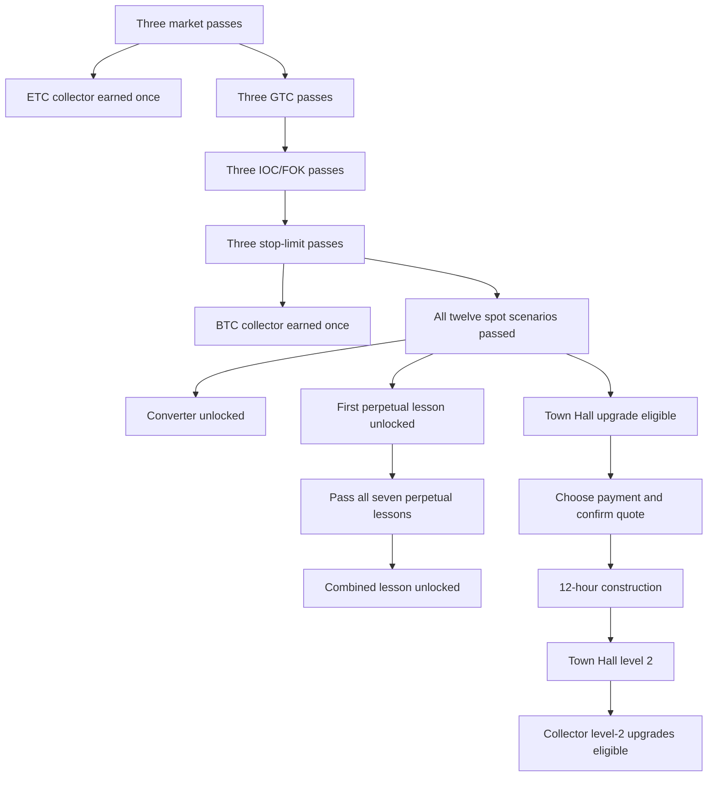

# COT — Designer handoff: visual inventory, screens and behavior

**Baseline: 26 November 2026.** This single file describes the player application built so far, including the logic that the design must represent. It is a browser prototype with a server-side mock backend. Final artwork, a production Go integration and native Android/iOS builds have not been delivered.

**Implementation boundary:** authoritative prototype logic runs on the server in `Frontend-COT/src/mocks/`, reached through `/api/mock/`. React renders returned values and captures intent. Its physical location in the frontend repository does not make that logic browser-owned.

**Product goal:** a village-based trading learning game. The player completes demonstrations, earns collectors, manages simulated resources and plans upgrades. Android is first; landscape is the primary design orientation, with a usable portrait fallback. iOS follows later.

**How to use this brief:** sections 1–4 define what needs designing; sections 5–15 explain behavior and edge states; sections 16–20 define data ownership, click flows, deliverables and pending decisions. The tables describe existing product behavior unless explicitly marked **recommended design deliverable** or **pending**. Numbers are current prototype settings, not permanent artwork or new production-economy decisions.

## 1. Supported instruments and what the player holds

All balances and trades in this prototype are **fictional/simulated**. Demo USD is not USDT. Asset names identify the simulated instrument; there is no real deposit, withdrawal, blockchain wallet connection or mining-hardware integration in the built player flow.

| Display name | Identifier | Wallet holding? | Spot/perpetual instrument? | Collector? | Current wallet capacity |
|---|---|---|---|---|---|
| Demo USD | `USD` | Yes; settlement/payment currency | Quote/collateral currency | No | 2,000 USD cash |
| Ethereum Classic | `ETC` | Yes | Yes | Yes | 350 ETC |
| Solana | `SOL` | Yes | Yes | No | 20 SOL |
| Bitcoin | `BTC` | Yes | Yes | Yes | Unlimited gameplay storage |

Design four recognizable currency icons and three tradable-instrument identities. Current scope has **no XRP, ETH, USDT or SOL collector**. Earlier naming proposals do not add instruments to this inventory.

A perpetual position is a separate contract exposure, not another pile of owned coins. For example, opening a BTC long must not visually increase the wallet's owned BTC units. Spot holdings, perpetual positions, committed margin, collector contents and pending credits need distinct labels.

The continuing starting allocation is **1,000 Demo USD once**, not once per lesson. Special fake tester-account balances are development fixtures, not normal player entitlements.

**Precision/layout:** ETC/SOL quantities accept up to 6 decimals; BTC quantities up to 8. ETC/SOL order prices accept up to 6 decimals; BTC prices up to 4. USD service amounts can carry up to 12 decimals. Allow long, tiny, zero and negative values in layouts; do not assume all financial values have two decimals. Engineering must agree any display-only rounding, and rounded text must never become a calculation input.

## 2. Actual buildings and required artwork

There are **three building entities**, one of each. Current maximum implemented building level is 2. Stable IDs must remain usable when artwork changes.

| Entity | ID | When available | Current level 1 | Current level 2 | Upgrade payment |
|---|---|---|---|---|---|
| Town Hall | `town-hall` | Starter village | Level 1 | Enables collector level-2 upgrades | Backend quote for $100 equivalent, paid in one supported asset |
| ETC collector | `ETC` | Earned after all 3 market-order scenarios pass | 1 ETC/hour; collector stores 50 ETC | 2 ETC/hour; stores 100 ETC | 0.001 BTC |
| BTC collector | `BTC` | Earned after all 3 spot stop-limit scenarios pass | 0.0001 BTC/hour; collector stores 0.005 BTC | 0.0002 BTC/hour; stores 0.01 BTC | 10 ETC |

Collector upgrades require completed Town Hall level 2. ETC upgrades the BTC collector; BTC upgrades the ETC collector. No automatic asset conversion pays an upgrade.

**Recommended art variants:**

- Town Hall level 1 and level 2; selected and unselected appearance; construction overlay.
- ETC and BTC collector identities, each with unearned/locked presentation, level 1, level 2, producing, empty, partly stored, full, collect available, collecting/request pending and construction overlay.
- A clear selected-building hit area, level label and resource identity. Keep readable UI text outside baked artwork.
- A completed-upgrade/unlock visual that can accompany a confirmed backend event. Cosmetic motion must not imply production, collection or payment already succeeded.

These are artwork/component states to design, not claims that final illustrations or every animation already exist. Current buildings are CSS placeholders. There is no building placement editor, extra copy purchase, wall/troop catalogue or level-3 building in this prototype.

## 3. Village facilities that are UI areas, not extra buildings

| Facility | Current implementation | What needs a design |
|---|---|---|
| Resource converter | Village panel and quote dialog | Source/destination selection, fixed amount, bonus, expiry, confirmation, cooldown and errors |
| Wallet/portfolio storage | Shared wallet table/panel | Four balances, capacities, free space and separate pending-credit claims |
| Learning hub | Learn screen | Market groups, lesson/scenario progression, goals, demonstration and results |
| Knowledge checks | Optional question panel | Question list, choices, accepted attempts, correct answer, separate explanation and reward |
| Emergency assistance | Claimable-offer panel | Eligibility reason, offered amount, claim, unavailable and already-used states |
| Recent activity/history | Village preview and paginated dialog | Event list, timestamps, load earlier, empty/loading/error states |

Do not count these as additional upgradeable building entities. A designer may **propose** a converter workshop or learning-hall visual metaphor, but that does not create a new building ID, upgrade cost or production rule. Any new gameplay entity needs a later product/backend decision.

## 4. Complete player screen and component inventory

| Screen/component | Essential information and actions | Required variants |
|---|---|---|
| Sign in | Account name, masked 4-digit PIN, inline help, sign in | Empty, editing, invalid name/PIN, incorrect credentials, submitting, unavailable service |
| Player shell | Player name, Demo USD, Village/Learn/Portfolio, sign out | Active, request busy, offline/stale, uncertain-command banner, session ended |
| Village overview | Three buildings, learning level, start/resume learning, unlock messages | Initial, collector unearned/earned, lesson active, upgrade eligible/in progress/completed |
| Building inspector | Selected building/level, eligibility reason, allowed payment asset, review cost | Locked, eligible, quote loading/error, constructing, cancellation review, maximum level |
| Collector panel | Asset, earned status, stored units, rate, collector capacity, Collect | Empty, producing, partial/full storage, wallet full, collect pending, lesson-blocked, settings unavailable |
| Converter panel | Pair, simulated prices/as-of, fixed source value, bonus, next availability | Locked, available, quote loading/review, insufficient source, destination full, cooldown, lesson-blocked |
| Quote/confirmation dialog | Server terms, expiry, confirmation; cancellation loss acknowledgement | Conversion, upgrade, cancellation, expired/rejected, submitting, close without confirming |
| Wallet/portfolio | Owned balances, unit capacities, free room; continuing versus practice context | Empty assets, near/full cap, BTC unlimited, unavailable data, owed credits |
| Learning hub | Spot/Perpetual/Combined groups, lesson list, 3 scenario cards per lesson, prerequisite reason | Locked/unlocked, 0/3–3/3, current attempt, passed/practice/retry |
| Active demonstration | Asset, current price/chart, timer, goals, observation message, order inputs, funds preview | Market/limit/stop-limit, different policies/products/leverage, preview loading/error, order sending |
| Order status/history | Accepted order, pending/triggered/filled/canceled, limit/stop, amount/side, cancel capability | Waiting, triggered waiting, immediate fill, no-match cancellation, user cancellation, deadline cancellation |
| Perpetual positions | Direction, leverage, quantity, exposure, entry/current values, margin/equity/PnL, Close | Long/short, gain/loss, close pending, comparison reference, liquidation, shared-funds rejection |
| Scenario result | Passed/not passed, requirement summary, cash/portfolio movement, practice label, next/retry/replay | Pass with gain or loss, fail, practice result, automatic settlement |
| Replay | Frozen report, asset/chart selection, event timeline, closes/comparison | Loading, success, read error, closed/replaced request |
| Knowledge checks | Available questions, selected choices, attempt count, feedback/reward | Locked, unanswered, wrong/free retry, correct first attempt, correct later, paid once |
| Assistance | Grant and server-provided availability/reason | Recovery needed, threshold not met, cadence unconfigured, fixture offer, claiming, claimed |
| Activity/history | Recent events, full retained history and earlier pages | Empty, populated, page loading/error, no more pages |
| Global dialogs/notices | Insufficient funds, session replacement, delivery unconfirmed, storage/quote errors | Clear reason, safe dismissal or corrective action, no duplicate sends |

**Design inventory also includes:** currency icons, building selection markers, lesson/progress/lock indicators, order-policy/status symbols, long/short and leverage badges, chart/axis/price labels, timer/review/readiness treatment, loading indicators, storage labels, pending-credit and reward/assistance treatments, and reusable buttons/dialogs/form fields. Dynamic labels and amounts remain live UI text.

## 5. Progression and unlock logic

A **pass** is successful completion of one required, distinct scenario. Repeating an already-passed scenario is practice and does not add another pass. All lessons contain three scenarios, currently with ETC/SOL/BTC suggested examples.

| Order | Group | Lesson | Required demonstration in each scenario |
|---:|---|---|---|
| 1 | Spot | Market orders | Fill a market buy **or** sell |
| 2 | Spot | GTC limit orders | See a limit order wait, then fill |
| 3 | Spot | IOC and FOK | Fill an IOC example **and** a FOK example |
| 4 | Spot | Stop-limit orders | Place dormant stop, observe trigger, then activated limit fill |
| 5 | Perpetual | Long and short at 1x | Open both directions at 1x, respecting one direction per asset |
| 6 | Perpetual | Compare leverage: same collateral | Open 1x, explicitly close it, then open the required 2x pair |
| 7 | Perpetual | Compare leverage: same size | Open 1x, explicitly close it, then open the required same-size 2x pair |
| 8 | Perpetual | Isolated liquidation at 5x | Observe an actual simulated 5x liquidation |
| 9 | Perpetual | Perpetual GTC limits | Pending limit followed by fill in perpetuals |
| 10 | Perpetual | Perpetual IOC and FOK | Filled examples of both policies in perpetuals |
| 11 | Perpetual | Perpetual stop-limit | Dormant stop → trigger → limit fill in perpetuals |
| 12 | Combined | Spot and margin: one wallet | Commit margin, experience the suggested unaffordable spot rejection, then fill an affordable spot buy |

Total: **12 spot + 21 perpetual + 3 combined = 36 scenarios**. IOC/FOK is one lesson with two required policy goals; it is not six separate scenarios. Later lessons unlock sequentially. The combined lesson opens after all 21 perpetual scenarios pass; no extra collector is awarded for perpetual or combined lessons.

**Learning level and Town Hall level are different.** Completing the 12 spot scenarios gives learning level 2 and access to converter/perpetual learning while Town Hall can still be level 1. Paying/waiting for Town Hall 2 is not a prerequisite for those learning unlocks. Later perpetual lessons still require previous lessons, not merely the group switch being visible. Questions never gate these unlocks. The trading groups are labeled Spot level 1, Perpetual level 2 and Combined level 3; that third trading stage does not mean a Town Hall level-3 building exists.

Only one scenario can be active for an account. Navigation away from Learn does not cancel, pause or restart it; provide a Resume action.

## 6. Order entry and matching logic

### Before placement

1. Player chooses a service-supported asset, side, quantity, product, leverage and order policy for that lesson. Limit/stop inputs appear only where relevant.
2. Show the **current simulated instrument price**, with units/as-of context, separately from the player's limit/stop price.
3. Request a backend preview. Display available Demo USD, reserved cash, available asset/contracts and maximum quantity. Perpetual previews also return notional, committed margin and required margin.
4. A preview is advisory and does **not** place or reserve an order. Acceptance validates funds, precision, storage, ownership, active attempt and allowed options again.
5. Only a confirmed backend result changes the displayed authoritative balance/order state. Do not animate an accepted payment before confirmation.

A failed preview is **unavailable information**, not zero balance. Show loading/error and Retry. Do not invent a universal $50 minimum trade: $50 is the converter amount and assistance threshold, not the order eligibility rule.

### Execution states

| Type/policy | Current simulated behavior | Design implication |
|---|---|---|
| Market | Immediate full fill at the server quote | Filled is different from pending; learning observation continues afterward |
| Limit GTC, already marketable | Immediate full fill, including price equality | GTC does not always wait; this valid trade alone does not meet the GTC lesson's waiting requirement |
| Limit GTC, not marketable | Reserve funds/assets/margin and wait for a guided matching event | Show accepted/waiting status, reserved funds and Cancel if permitted |
| Limit IOC | Immediate full fill if marketable; otherwise immediate cancellation | Do not leave a waiting order |
| Limit FOK | Immediate full fill if marketable; otherwise immediate cancellation | Show policy and cancellation reason clearly |
| Stop-limit GTC | Dormant accepted stop → triggered/activated limit → filled | Triggered is not filled; these need visually distinct states |

Current order statuses are `PENDING`, `TRIGGERED`, `FILLED`, `CANCELED`. The simplified engine has **no partial-liquidity/partial-fill model**; do not represent a partially-filled state as already implemented. Real exchange behavior is future integration work.

For a buy, limit at/above current price is marketable; for a sell, limit at/below current price is marketable. Unmatched guided GTC and stop-limit follow the accepted scenario timing in section 7.

An accepted pending order must read like **“Order placed — waiting to fill”**, not a failed first placement. A second guided pending order for the same asset is blocked separately. Offer Cancel only when the service says `canCancel`. A fill becoming due can win a race with cancellation; refresh and explain the authoritative result. Order cancellation releases reservations; the construction cancellation loss rule does not apply to canceling an order.

## 7. Timers, observation, Fast-forward, results and replay

Current settings: **180-second scenario deadline; guided fill +60 seconds; stop activation +30 seconds; final review 20 seconds.** Timing terms are frozen when a scenario is accepted.

- The 180-second countdown starts when the scenario starts.
- Guided execution and learning observation timing are relative to acceptance of the relevant order/action, not to the beginning of the countdown.
- Example: accepted at elapsed 20s → stop trigger at 50s if applicable → guided fill at 80s → typical earliest Fast-forward at 100s after review.
- A market order can fill immediately at acceptance. Its 60-second learning observation plus 20-second review still apply; do not delay its fill animation merely to make the learning timer last a minute.
- Required multi-step lessons must finish all required evidence. Readiness also waits at least 20 seconds after the actual required outcome, and the service may return a later time for relevant later steps. Render its readiness/message; do not implement a separate frontend formula.
- Fast-forward appears only when `canFastForward` is true. It moves to the scenario-end result/settlement; it does not create a pass or guarantee profit.
- At the 180-second deadline, completed trading requirements can pass even if observation/review time ran out or the player was disconnected. Review can happen in replay. Profit and optional quiz answers are not pass conditions.
- Guided fill due exactly at the deadline executes; one due after the deadline does not. For example, GTC accepted at 120s can fill at 180s, but accepted at 121s would fill too late and be canceled at settlement if still pending.
- Disconnection/backgrounding does not pause the server clock. On return, show reconciled state/results rather than restarting the lesson timer.

At lesson end, the service cancels remaining pending orders and closes remaining perpetual positions. Spot sells consume lesson-purchased units first. Example: player already owns 20 ETC, buys 5, then sells 3 → sell the new 3, settle the remaining new 2 at the end, preserve the original 20 unless the player separately sold them.

Result design needs pass/fail, requirement summary, cash movement, portfolio-value movement and next/retry/replay actions. Negative PnL can accompany a pass. Cash movement and portfolio movement are different measures; collected-resource inflows are not trading profit.

A completed scenario can be replayed as **practice using an isolated copy**: real wallet, real marks, progress and rewards remain unchanged. Practice is labeled clearly. A failed real scenario may be retried, but the continuing wallet is not refilled. Replay reports are frozen, read-only history, not a new trade or a recalculation against today's wallet.

## 8. Perpetual positions and shared funds

Design spot holdings and perpetual exposure as distinct concepts:

- **Notional/exposure:** quantity × execution price. This is not spendable cash or owned spot units.
- **Initial margin:** server-calculated notional/leverage, rounded safely by the service.
- **Available cash:** cash minus pending cash reservations and committed margin. Cash shown in the wallet includes committed collateral; available cash excludes it.
- **Unrealized PnL:** fluctuates with simulated marks; it is not spendable. Explicit closing/settlement realizes PnL into Demo USD and releases applicable margin.
- **Equity/maintenance:** service-calculated position values. Current training maintenance is 1% of current notional, rounded by the service; liquidation occurs at the service's breach condition.

One asset cannot simultaneously have opposite directions or different leverage positions. Close before reversing/changing leverage. For long/short learning, use different assets simultaneously or close the first direction before opening the other on the same asset.

The two comparison lessons involve **actual sequential 1x → explicit close → 2x trades**. Same collateral compares exposure; same size compares required collateral. Use service-provided next-order guidance. Hypothetical 10% favorable/adverse illustrations must be labeled hypothetical and kept separate from actual realized results; entries can occur at different prices.

For 5x liquidation, show the forced close, equity, maintenance, released collateral, recognized PnL, raw PnL and training backstop. The selected **isolated training backstop caps charged loss to that position's collateral**. It is a simulation rule, not a promise about a real exchange. Do not show a liquidation button as a normal player shortcut.

Combined lesson example: cash 100, margin committed 80, other reservations 0 → available for spot is 20. The suggested unaffordable spot order must show the backend rejection and current limits, followed by an affordable correction. Rejection records learning evidence but moves no cash/assets and earns no successful financial receipt.

## 9. Collector production and collection

Collector storage and owned wallet storage are different. For example, level-1 ETC collector capacity is 50 ETC while the ETC wallet capacity is 350 ETC.

- Each collector's current store holds 50 hours of its level's production; level 2 doubles both rate and capacity.
- Offline production accumulates up to collector capacity. Time spent already full is discarded, not backfilled after collection.
- Collection transfers only what currently fits in wallet headroom. If 10 ETC is stored and only 3 ETC fits, collect 3 and leave 7 in the collector.
- If the wallet has no room, display the reason and unavailable Collect action. Leftover collector units do not become pending credits merely because collection was partial.
- Production keeps the old rate/capacity during an upgrade. The accepted new effect starts at the actual completion timestamp, including offline periods.
- Empty/unearned is different from failed/unavailable data or service-reported missing production settings. Do not turn missing data into a fake zero rate.

Use backend `stored`, `ratePerHour`, `capacity`, `canCollect` and reason/status. A decorative production animation is not evidence that units were credited. Any proposed gauge should be agreed with engineering as presentation of authoritative values, not a new production calculator.

## 10. Conversion flow and rules

The converter unlocks after all 12 spot passes. The first use can be available immediately, but current funds/storage/manual-action eligibility still apply.

1. Choose source and a **different** destination among USD/ETC/SOL/BTC.
2. The player **does not enter a quantity**. Require at least $50 available source value; the backend quotes representable source units at or below the nominal $50 and discloses rounding change.
3. Review the server's exact source debit, received base amount, **25% destination bonus**, any source change, zero fees, expiry and volatility explanation.
4. Confirm the quoted transaction. Only success starts the cooldown.
5. Block **all conversions for 48 hours after success**, including ordinary conversions without bonus. Preview, rejection or dismissing a quote does not consume the cooldown.

Destination storage must fit base plus bonus. Same-asset pairs, insufficient source value, a zero received amount, insufficient destination room, active lesson or active cooldown reject without conversion. Show the affected instrument and available room/balance, not just “failed.”

Quotes last **30 seconds**, reserve no funds and belong to the player. Confirmation rechecks current eligibility/funds/room while honoring frozen accepted quote terms; a policy-version change alone does not silently reprice or invalidate those terms. Expired quotes need a fresh review.

Fractional bonus/change entitlements are preserved by the service rather than discarded; whole valid units credit to the wallet and smaller owed portions remain pending. The display must not invent a fee from rounding differences.

An explanatory example, **not a current market quote**: at 10 Demo USD per ETC, a $50 USD→ETC base conversion is 5 ETC plus a 1.25 ETC bonus. Actual amounts always come from the binding quote. State clearly that the value of held assets can fluctuate after conversion; current prototype prices are simulated, not a live external feed.

## 11. Upgrade, cancellation and restart flow

- Completing 12 spot scenarios makes Town Hall 1→2 eligible. Its current cost is $100 equivalent in **one** of USD/ETC/SOL/BTC, with exact payment units supplied by the backend.
- Town Hall 2 makes earned collectors eligible for 1→2 upgrades: ETC collector costs 0.001 BTC; BTC collector costs 10 ETC.
- Every accepted upgrade currently takes **12 hours**, starting at confirmation. Review quote → confirm full payment → show original paid units and finish time → complete on authoritative server time.
- No mixed-asset payment, automatic sale or automatic conversion. Resource planning and the separate converter cooldown remain meaningful.
- One active construction per building. Configured concurrency is 20 at Town Hall levels 1/2, but only three building entities exist; do not infer 20 physical building copies or a currently rendered 20-slot counter.
- Current maximum implemented level is 2. Future levels/costs/artwork require definitions rather than guessed defaults.

Cancellation needs its own quote and explicit acknowledgement: **refund 50% of original construction cost in the original paid asset; lose the other 50%**. Display refund and loss before confirmation. Dismissing the review sends no cancellation.

Refund terms bind the original construction, not a new price/cost policy. Excess/fractional refunds remain pending credits. At the exact completion timestamp, completion wins over a new cancellation. After cancellation, restarting means a **fresh full payment, construction identity and full 12-hour timer**, not continuation of the canceled timer.

## 12. Wallet capacity, asset value and pending credits

| Concept | Required presentation/behavior |
|---|---|
| Cash cap | 2,000 Demo USD cash, not a cap on the entire portfolio |
| Asset caps | Fixed units: 350 ETC, 20 SOL, BTC unlimited gameplay storage |
| Portfolio valuation | Can exceed $2,000 because asset values change; price movement does not create/delete owned units |
| Optional incoming purchase/conversion | Must fit current capacity, including applicable reservations/bonus; otherwise reject before effects |
| Collector transfer | Partial collection is allowed; leftover stays in collector |
| Earned profits/refunds/rewards | Overflow is preserved as pending credits, not discarded or silently spendable |
| Claim pending credit | Service selects valid units that fit; transfers already-owned value, not a second reward/PnL event |
| Tiny fractional entitlements | Retained server-side; show an explanatory retained-fraction state if returned |

Show pending **owed** amount separately from **claimable now**, and clearly disable Claim when nothing can currently fit. Claims preserve per-origin accounting; the designer need not implement FIFO or fractional arithmetic. Do not portray technical numeric limits as a finite BTC gameplay storage cap.

## 13. Optional knowledge checks

There is one server-owned question per lesson: **12 questions total**, unlocked after that lesson's three scenarios pass. Topics cover market valuation, GTC acceptance versus fill, FOK, stop activation, direction rules, leverage/collateral/size, isolated liquidation, perpetual policies and shared funds.

- Questions are optional; they never gate trading progression, a pass or Fast-forward.
- A valid wrong answer is free to retry. Unlimited retries are allowed.
- Correct on the first accepted attempt pays **5 Demo USD**; correct on any later attempt pays **2.50 Demo USD**, never reduced further.
- Reward is paid once, including any pending credit. Replaying, relogging or later text changes does not earn it again.
- A stale question revision or a retried network command is not a new graded attempt.

Design feedback as separate blocks: **Correct answer: [option]**, then **Explanation**, then reward/attempt information. Do not append the explanation into an option label or expose a static answer key in the frontend asset bundle. Prompt, choices, revision, grading, attempts and rewards are service data. Design for long question/choice text and wrong/correct/previously-paid states.

## 14. Emergency assistance

Current threshold: **cash strictly below $50**. Offer amount: an **extra $100**, not a top-up to $100. For example, $20 becomes $120; exactly $50 is ineligible.

The backend first checks usable recovery routes: claimable pending credits, collectible resources and an actually available converter recovery. It does not force a sale, conversion or position close. Active demonstrations block a new claim, so reserving funds cannot manufacture eligibility.

Assistance is a claimable, owned, single-use offer that is rechecked when claimed. The normal cadence/repeat configuration is **still pending real testing**; the ordinary current configuration makes no scheduled offer. A development fixture can expose one eligible claim for testing, which is not a promised production reward schedule.

Design the offered, recovery-required, threshold-ineligible, configuration-pending, claiming and claimed/unavailable states. Display service reason/amount; do not automatically credit money from a frontend `balance < 50` check or equate this threshold with a minimum trade size.

## 15. Identity, session, connectivity and safety states

### Login/session

- Account name: **1–10 lowercase letters a–z**. Digits, underscores, uppercase and special characters produce inline feedback.
- PIN: **exactly four digits 0–9**, masked. Reject letters/special characters, prevent more than four digits and preserve leading zeros.
- Backend independently validates input/credentials. Current access uses assigned fake tester accounts; public sign-up/account recovery is not implemented.
- **One active signed-in session per account.** A successful sign-in on another device replaces the old session. Backend revocation is immediate; an offline old device learns this on its next request/reconnect.
- Show the old device's “Signed in on another device” notice and return to sign-in. Do not design a permanent device counter/badge or an earlier three-device management screen as current player functionality.

### Request and recovery states

| Situation | Required UX |
|---|---|
| Initial/slow read | Loading state; never fabricated zero balances or ready buttons |
| Failed price/preview/read | Explain unavailable data; preserve appropriate known state and provide retry |
| Known offline before a new action | Explain reconnect is needed; do not present the action as already queued/executed |
| Sending a command | Prevent duplicate new actions; use a busy state without optimistic money/award changes |
| Response lost/uncertain delivery | Keep an “unconfirmed” banner and **Retry original command**, not a fresh second command |
| Terminal rejection | Show safe backend reason and corrective action; rejected finance does not count as a successful payment |
| Insufficient trade funds | Dialog shows available USD, available selected asset/contracts, maximum quantity and requested quantity |
| Expired/consumed/wrong quote | Explain the reason; return to fresh review rather than resubmitting changed terms invisibly |
| Session replaced/removed | Clear authority and show sign-in/session notice; never adopt another account's response |
| Out-of-order response | Keep newer current-session state; stale replies must not roll balances, selections or dialogs backward |
| Storage full | Name the destination/storage type; explain partial collection versus rejected optional purchase/conversion |

New conversion, collection, upgrades/cancellation, pending claims, answers and assistance are blocked during **both real and practice active demonstrations**, even after navigating to Village. Accepted automatic fills, production, settlement and construction continue. Navigation and dismissing a dialog do not pause the game. Replaying an already-confirmed receipt is recovery, not a new manual action.

## 16. Backend versus frontend versus designer ownership

| Owner | Owns |
|---|---|
| Backend (mock now; production service later) | Identity, prices, exact quantities/rounding, balances, reservations/margin/PnL, limits, matching, timers, goals/pass/unlocks, production, storage, construction/refund terms, conversion/bonus/cooldown, grading, rewards, assistance, durable receipts/history |
| Frontend | Render returned values, capture unsent choices/text/acknowledgement, navigation/focus/dialogs, readable responsive layouts, local timestamp formatting and safe request/retry identity |
| Designer | Hierarchy, building/resource art, component variants, information clarity, interaction/motion specification, accessibility and orientation layouts that preserve the agreed rules |
| Backend + future operations/back office | Validate/version and deliver runtime settings, staff permissions/audit, accepted-term protection, explicit migrations; no staff editor is built in the player prototype |

A disabled button communicates eligibility; it is not backend enforcement. Design copy/flags must come from service state where available. Backend decisions must not be recreated in a form, animation or a Figma interaction.

**Useful design data bindings:**

| UI area | Authoritative fields |
|---|---|
| Village/building state | `economy.learningLevel`, `economy.buildings[]`, `economy.constructions[]`, `economy.announcements` |
| Collectors | `generators[]`: earned/level/stored/ratePerHour/capacity/canCollect/status |
| Converter | `economy.converter`, `economy.prices[]`, quote ID/lines/expiry/confirmation |
| Wallet/pending credits | `economy.wallet[]`, `economy.credits[]`; continuing USD is also exposed as `demoUsd` |
| Course/market switch | `marketGroups[]`, `course.lessons[].variants`, unlocked/lockedReason, completion counts |
| Demonstration | `lesson`: form options/asset rules, quotes/history, orders, goals, observation, remainingSeconds/canFastForward, result |
| Funds/limits | `OrderPreview` and safe insufficient-funds details; not a frontend affordability formula |
| Perpetuals | `lesson.positions[]`, comparison/nextOrder, liquidations, marginRejection/sharedFundsExample |
| Questions/assistance/history | `economy.questions[]`, `economy.assistance`, recent `economy.history`; full paginated history response |
| Replay | Frozen `Report`; title/practice/result/quotes/events/comparison/closes |

Fields such as report opening/closing snapshots may exist for inspection without currently being directly rendered. Additional visual metrics need an agreed service contract; do not imply every API field already has a player-facing widget.

## 17. Current click-to-service map

All paths here are current mock routes under **`/api/mock/`**; they do not assert that matching production Go routes already exist. Most mutations return current state plus an accepted-intent receipt. Commands use a stable intent identity so retrying cannot double-charge/reward.

| Player action | Current request | What the design should show afterward |
|---|---|---|
| Sign in | `POST sign-in` | Authoritative player state or safe credential error |
| Refresh/resume | `GET state` | Current timer/progress/wallet/capabilities; due events reconciled |
| Switch app tab/building/draft/chart asset | Frontend selection; no financial mutation by selection alone | Changed context/inputs only |
| Start scenario | `POST command`, action `start` | One active attempt, goals, form and deadline |
| Check order limits | `POST order-preview` | Advisory current limits/loading/error; no placed order |
| Place trade | `POST command`, action `order` | Accepted order/status/funds/position or rejection |
| Cancel pending order | `POST command`, action `cancel` | Authoritative cancellation/reservation release or already-executed outcome |
| Close position | `POST command`, action `order`, service-provided `reduceOnly` close order | Reduced/closed position and realized result |
| Fast-forward | `POST command`, action `finish` | Scenario-end result and settlement |
| Collect | `POST command`, action `collect` with collector asset | Updated stored/wallet amounts or reason |
| Review conversion | `POST quote`, kind `conversion` | Exact pair terms and confirmation dialog |
| Review upgrade/cancellation | `POST quote`, kind `upgrade` / `cancellation` | Exact cost/timer or refund/loss terms |
| Confirm conversion/upgrade | `POST command`, action `convert` / `upgrade`, owned quote ID | Committed updated state or revalidation failure |
| Confirm construction cancellation | `POST command`, action `cancel-upgrade`, quote ID + acknowledgement | Refund/pending credits and canceled construction |
| Claim owed value | `POST command`, action `claim-credit` | Transfer into available wallet room |
| Submit answer | `POST command`, action `answer`, question ID/revision/option | Correct answer, separate explanation, attempts and once-only reward |
| Claim assistance | `POST command`, action `claim-assistance`, offer ID | Extra funds/pending amount or updated eligibility reason |
| Open replay | `GET report?attemptId=...` | Frozen read-only report |
| Load earlier history | `GET history` with cursor | Earlier events/loading/error/end of list |
| Sign out | `POST sign-out` | Revoked session and sign-in screen |

Developer clock/reset/export/policy tools, API-only projections and the Architecture explorer are engineering aids, **not player screens requiring village artwork**. There is no player-facing operator/back-office application in the current delivery.

## 18. Runtime settings: keep values out of artwork

These are current displayed settings and rules, not values to bake into a building sprite, button image or permanent explanatory text. Only settings exposed by the backend policy are runtime-editable; the table does not create new back-office controls.

| Area | Current value |
|---|---|
| Starting funds / wallet caps | 1,000 USD once; USD 2,000 / ETC 350 / SOL 20 / BTC unlimited gameplay storage |
| Scenario timing | 180s total; guided fill +60s; stop activation +30s; review 20s |
| Conversion | $50 nominal source; +25%; zero fees; 30s quote; 48h cooldown after success |
| Construction | 12h; Town Hall $100 equivalent; ETC collector 0.001 BTC; BTC collector 10 ETC |
| Cancellation | 50% original paid units refunded in original asset |
| Production | ETC 1/h→2/h, stores 50→100; BTC 0.0001/h→0.0002/h, stores 0.005→0.01 |
| Construction concurrency | 20 configured at Town Hall 1/2; one active upgrade per building; only three building entities |
| Question reward | 5 USD if correct on first accepted attempt; 2.50 on any later attempt; paid once |
| Assistance | Below 50 cash; extra 100; ordinary cadence/repeat tuning pending |

Zero conversion fees, the supported instrument/building catalogue, the lesson structure and single-session behavior are current service rules, not all existing runtime-policy fields. Changing such rules requires an explicit backend/product change; the designer must not add a fee slider, new asset or new entity as if already supported.

Accepted scenario, quote and construction terms are pinned rather than retroactively rewritten by a settings change. Existing earned production settings require an explicit effective-time migration. Structural precision, ownership checks, once-only payments/rewards and financial conservation are integrity constraints, not arbitrary designer/back-office toggles.

The intended future path is **operations/back-office delivery → backend validation/versioning → backend decisions → returned UI state**. The frontend displays the result. Production configuration administration is still future work.

## 19. Recommended designer delivery package

This is a **recommended handoff checklist**, not a claim that a design system or final renderer has already been approved.

- A labeled screen/interaction flow covering sign-in → village → learning → result/replay and the economy flows above.
- Landscape Android layouts first, plus portrait and smaller-screen fallbacks; navigation that does not hide essential actions or require hover.
- Component variants for every state in sections 4 and 15, including long amounts, empty/locked/unavailable states and pending delivery.
- Building/collector art variants from section 2 and the complete icon inventory from sections 1 and 4, with consistent names and separable selection/construction/state layers.
- Figma components/tokens for typography, spacing, colors, buttons, fields, dialogs, tabs, status indicators, charts and progress. Use text/icons in addition to color for loss, rejection, locks and order states.
- Explicit interaction specifications: tap targets, pressed/disabled/busy states, focus, dialog dismissal/back behavior, keyboard avoidance, safe-area/system-bar layouts and accessibility text scaling.
- Motion notes distinguishing cosmetic animation from confirmed order fill, collection, reward, construction completion and liquidation. Support reduced motion; never make an animation finish a financial timer.
- Editable source artwork and agreed export sizes/formats. Scalable icons and separated building layers are sensible starting deliverables, but final raster/sprite/vector/3D packaging depends on renderer selection.
- Annotated backend-bound text/value fields and a click map matching section 17; do not bake prices, rates, costs, balances, goal completion or cooldown times into images.
- A review sheet marking each item approved, proposed or pending. Visual polish must not silently introduce new buildings, assets, rewards or pass conditions.

Native Android/iOS builds, physical-device performance, system Back integration, credential storage and lifecycle behavior still require platform implementation/testing. Browser dimensions/touch emulation are not proof of native-device compatibility. The application must refresh authoritative state after background/resume rather than restart business timers.

## 20. Pending decisions, references and review checklist

| Pending area | Who needs to decide | Designer should do now |
|---|---|---|
| Final art style, palette, branding and motion | Product + design | Propose a coherent direction; current CSS art is placeholder |
| Final renderer/export pipeline | Product + frontend/platform + design | Keep editable assets and agree export requirements before final packaging |
| Native shell/orientation/platform behavior | Frontend/platform + design | Supply landscape, portrait fallback, safe-area and Back/dialog intent; await native validation |
| Building levels beyond current level 2 / additional entities | Product + backend + design | Provide reusable templates; do not invent values or claim new levels are implemented |
| Ordinary assistance cadence/repeat tuning | Product + backend, informed by testing | Design configurable availability/reason/offer states, not a fixed recurring giveaway |
| Real external-market/liquidity behavior and production operations | Backend/platform/product | Preserve current simulation labels; update flows only when integration contracts are agreed |
| Any new physical converter/learning/quiz building | Product + design + backend if mechanics change | Treat as a visual proposal or future entity, not an existing upgradeable building |

The pending choices above do not block documenting or designing the settled prototype behavior. They are recorded for later decisions; this brief does not approve a new feature.

**Reference points in the main COT directory:**

- `Architecture explorer/` — this file and the interactive engineering map. Run `npm start` here, then open `http://127.0.0.1:3102`.
- `Frontend-COT/docs/phase-5-11.md`, `backend-handoff.md`, `client-responsibilities.md`, `platform-handoff.md` — settled prototype, integration and ownership details.
- `Frontend-COT/src/mocks/policy/defaults.json`, `catalog.ts` — current tunable values and structural asset metadata.
- `Frontend-COT/src/mocks/market/course.ts`, `book.ts`, `execution.ts`, `evidence.ts`, `perpetual.ts` — course, execution, timing, settlement and risk behavior.
- `Frontend-COT/src/mocks/economy/book.ts`, `resources/book.ts` — conversion, construction, credits, questions, assistance and collectors.
- `Frontend-COT/src/api/{types,market-types,economy-types}.ts` and `src/features/` — returned data and current screens. The Go repository is not the implemented mock service.

Localhost is a local preview, not a hosted designer collaboration link. Share this file plus agreed screenshots/source access, or run the COT checkouts on the designer's machine. Final designer assets/Figma files can be attached to the agreed handoff later.

**Before accepting the design:**

- [ ] Four wallet identities; three trading symbols; exactly two collectors and three actual buildings.
- [ ] Collector capacity is distinct from wallet capacity, and learning level from Town Hall level.
- [ ] All 12 lessons / 36 distinct scenarios and optional question states are represented.
- [ ] Preview/quote is distinct from acceptance; pending/triggered/filled/canceled are distinct.
- [ ] Immediate marketable fills are not delayed just to represent learning observation.
- [ ] Deadline, pass without profit, Fast-forward readiness, offline return and practice/replay are explained correctly.
- [ ] Current price, available funds and maximum quantity are visible before ordering.
- [ ] Shared margin, long/short rules, sequential comparisons and liquidation/backstop are understandable.
- [ ] Conversion, storage, cooldown, construction cancellation loss and restart are disclosed before confirmation.
- [ ] Unconfirmed delivery and safe retry cannot look like a second payment; unavailable data never looks like zero.
- [ ] All business decisions stay with the backend, all configurable numbers stay dynamic, and pending/native features remain labeled.
